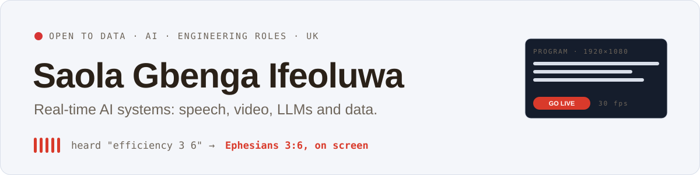

<a href="https://ife-gsaola.github.io">
  <picture>
    <source media="(prefers-color-scheme: dark)" srcset="banner.svg">
    <source media="(prefers-color-scheme: light)" srcset="banner-light.svg">
    
  </picture>
</a>

### Hey, I'm Gbenga 👋

I build **real-time AI systems**, the kind that have to be right the moment they run: streaming speech recognition turned into exact results, a native C++ engine streaming video up to 4K, and LLM pipelines that do real work.

MSc in Artificial Intelligence (University of Wolverhampton, 2025). Before that, three years in data: SQL, reconciliation, dashboards and data quality at SecureID and Ipsos.

🔴 **Open to Data · AI · Engineering roles in the UK.** [Portfolio →](https://ife-gsaola.github.io)

---

### What I'm building

**🎬 AuraCast Studio**: desktop live production. Cameras, graphics, audio and streaming in one app.
A native C++ engine (FFmpeg, Direct3D 11 on Windows) streams up to 4K. Sonic Core, my real-time audio engine, does no locking and no memory allocation on the audio thread. Phones become wireless cameras through native Swift and Kotlin apps, with NDI and YouTube Live out.
> *Behind the build:* on Windows, a digital mixer shows up as separate stereo USB pairs instead of one device, so the engine rebuilds the channels itself.

`C++` `FFmpeg` `DSP` `TypeScript` `React` `Electron` `Swift` `Kotlin`

**🗣️ Auto Verses**: real-time speech-to-entity resolution.
Streaming ASR (Web Speech or local Whisper) feeds a phonetic matcher (custom sound keys and edit distance), with semantic search on an offline, quantised MiniLM embedding model as a fallback. It follows context and takes voice commands. 35 automated tests.
> *Behind the build:* offline Whisper "heard" words in silence; a baby breathing became "Verse 16". I moved recognition to a browser speech engine bridged over a token-protected local server, then built the matcher for its errors: "efficiency 3 6" resolves to Ephesians 3:6, and 27 of 28 misheard names are resolved.

`TypeScript` `Whisper` `Web Speech` `MiniLM` `Transformers.js` `NLP`

**🧭 ApplyPilot**: an LLM pipeline for job applications.
It collects jobs from public APIs and careers platforms (Greenhouse, Lever, Ashby), rewrites the CV for each job as reviewable diffs with guardrails so it never invents experience, generates letters, and fills forms through a Manifest V3 Chrome extension that only submits on your click.

`React` `TypeScript` `Supabase` `LLMs` `Chrome extension` `LaTeX`

**🏢 Sanctuary**: a multi-tenant SaaS platform underneath. Tenants are isolated by Postgres row-level security (500+ policies), with 53 Deno serverless functions and a WhatsApp Cloud API inbox.

> These repositories are private. [Ask me about any of them →](https://ife-gsaola.github.io/#contact)

---

### Data & ML work (public here)

| Project | What it does |
| --- | --- |
| 🍲 [**Snap-and-speak food recogniser**](https://github.com/ife-gsaola/img_streamlit_app) | A CNN names a dish from a photo and says it aloud in your language |
| ☁️ [**An LLM on AWS**](https://github.com/ife-gsaola/hugging-face-llm) | A Hugging Face model on SageMaker, behind Lambda, with a React front end |
| 🗄️ [**Inventory data warehouse**](https://github.com/ife-gsaola/SQL) | Raw data → staging → EDW, built with SQL stored procedures |
| 🤖 [**ML coursework**](https://github.com/ife-gsaola/ai_projects) | Credit risk, house prices, sunspot forecasting, CNNs, a neural recommender |
| 📊 [**Statistics in R**](https://github.com/ife-gsaola/Rcode_projects) | The 2021 England Census, explored in Quarto |

---

### Tools

**AI & ML:** Python · reinforcement learning · neural networks · TensorFlow/Keras · scikit-learn · Hugging Face · Whisper · embeddings 
**Data:** SQL (advanced) · BigQuery · Databricks · Apache Kafka · data warehousing · Power BI · Qlik Sense · R 
**Cloud & software:** AWS · Azure · Supabase/Postgres · TypeScript · React · Node · C++ · Swift · Kotlin · ESP32/Arduino

**Certificates:** Google Project Management (2025) · IBM Database Administrator (2025)

**How I work:** I write the brief, the rules and the tests, then build with AI coding agents, and nothing merges until I've reviewed it.

---

  <a href="https://ife-gsaola.github.io">Portfolio</a> ·
  <a href="https://github.com/ife-gsaola?tab=repositories">Repositories</a> ·
  <a href="https://ife-gsaola.github.io/#contact">Say hello</a>

